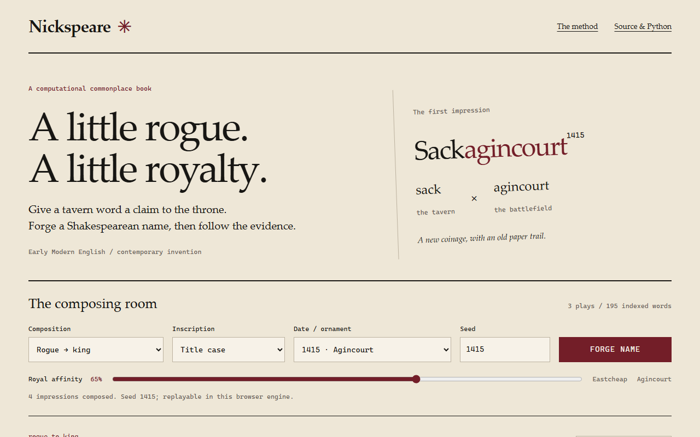

# Nickspeare

A Shakespearean nickname generator with source-linked provenance and a browser composing room.

[简体中文](README.zh-CN.md) · [Live demo](https://styayur.github.io/Nickspeare/) · [Published v1.0.0](https://github.com/styayur/Nickspeare/releases/tag/v1.0.0)

**Stage: Experimental.** Python and browser workflows have automated checks; independent installation, upgrade and sustained user validation remain outstanding. Current source declares 1.1.0; the latest published release is v1.0.0. Source examples below describe the current source, not a promise about the older wheel.



## Features

- Generate invented names from Shakespearean ingredients and inspect speaker ties, source locations, formation choices and historical date explanations.
- The current evidence atlas indexes 195 words from *Henry IV, Part 1*, *Henry IV, Part 2* and *Henry V*, with source hashes and XML identifiers.
- Compare ranked blends and character Markov candidates. Seeded records make runs replayable within one engine/version.
- The browser runs locally without a generation API or key. Inspect the four-stage formation, select alternatives, share replay settings and export JSON.

Evidence attests the ingredients, not the invented name. The scoring and editorial choices are explained in [Methodology](docs/METHODOLOGY.md).

## Installation / Quick Start

### Browser

Open the [live demo](https://styayur.github.io/Nickspeare/) and choose **FORGE NAME**. Inspect the paper trail and formation steps before copying a name or exporting its record. To serve the same static UI locally, clone the repository and run from its root:

```sh
git clone https://github.com/styayur/Nickspeare.git
cd Nickspeare
python -m http.server 8765 --directory docs
```

Open `http://localhost:8765`. Python serves the files; nickname generation runs in the browser. The packaged atlas is included, so a corpus download is not needed for ordinary generation.

The browser keeps the current results in memory, without a saved-history store. Export JSON to keep a record; replay links expose the rule, style, suffix, seed, affinity and selected impression in their URL. They are not private backups. Exported JSON is a record, not an importable project file; replay is tied to the browser engine/version.

### Python from source

Use Python 3.9+; there are no third-party runtime dependencies. A virtual environment is recommended.

```sh
git clone https://github.com/styayur/Nickspeare.git
cd Nickspeare
python -m pip install -e .
python -m nickspeare generate -n 10 --seed 42
python -m nickspeare generate -n 5 --rule rogue_to_king --year-theme agincourt --royal-affinity 0.85 --json
python -m nickspeare generate -n 5 --rule markov_coin --suffix none --seed 42
```

Python offers `rogue_to_king`, `quote_splice`, `archaic_coinage`, `markov_coin` and `markov_epithet`; the browser offers the first four. `--suffix none` adds no year, `number` adds a nonhistorical ornament, and `both` chooses a historical or numeric suffix. Run `python -m nickspeare generate --help` for styles and other options.

```python
from nickspeare import NicknameGenerator

engine = NicknameGenerator(seed=42, royal_affinity=0.85)
name = engine.generate_one(rule="rogue_to_king", year_theme="agincourt")
print(name.variant)
print(name.as_dict()["provenance"])
```

For a fixed published package, download the wheel attached to [v1.0.0](https://github.com/styayur/Nickspeare/releases/tag/v1.0.0) and install that local file. No PyPI availability or 1.1.0 release is implied. Corpus rebuilding and optional R/RStudio analysis are covered in [Development](docs/DEVELOPMENT.md).

From the download directory, in a separate virtual environment from the editable source install:

```sh
python -m pip install ./nickspeare-1.0.0-py3-none-any.whl
```

## Testing / CI / Platform Support

[](https://github.com/styayur/Nickspeare/actions/workflows/ci.yml)

From the repository root, use Python 3.9+ and Node.js 22 (CI; the manifest allows Node 20+):

```sh
python -m pip install -e '.[dev]'
python -m unittest discover -s tests -v
npm test
python -m build
```

For browser integration, install Chromium with `python -m playwright install chromium`, serve `docs` as above, then run `python scripts/check_browser.py` in a second terminal from the repository root.

The [Verify workflow](.github/workflows/ci.yml) tests Python 3.9/3.12/3.14 and headless Chromium on Ubuntu, including replay, export, clipboard, formation steps, responsive layout and load failure. [CodeForge regression](.github/workflows/codeforge-regression.yml) is a separate development gate. These checks do not certify every browser or operating system; GitHub Pages serves `main:/docs`.

## Known Limitations

- Generated names are neologisms, not Shakespeare quotations or historical pronunciation reconstructions. Speaker groups are editorial interpretations, and rare-word associations remain uncertain.
- Python and browser use different RNGs and transformation rules. Seeds replay within an engine/version, not across engines.
- The provenance atlas covers three plays and 195 words. Supplemental training corpora do not automatically extend the committed evidence index.
- R is optional analysis tooling; its exploratory output is not the published evidence atlas. Independent installation, upgrade and sustained user acceptance have not been audited.

## Roadmap

Current source already provides generation and per-name provenance. Next work is a reviewed corpus extension and clearer evidence views; broader computational-humanities comparisons remain future experiments. See the [corpus acceptance workflow](docs/corpus-extension.md). Ungrounded generation and commercial name services are not planned.

## Contributing

Read [CONTRIBUTING.md](CONTRIBUTING.md) and [Development](docs/DEVELOPMENT.md). Bug reports should include the engine/version, seed, rule, suffix and exported record. Use [Issues](https://github.com/styayur/Nickspeare/issues) for reproducible bugs and [SECURITY.md](SECURITY.md) for vulnerabilities. New corpus evidence needs reviewed hashes and attribution.

## License

Code is [AGPL-3.0-or-later](LICENSE). The cached Folger edition and its derived atlas retain **CC BY-NC 3.0** attribution and noncommercial restrictions; the code license does not relicense those data. See [Sources and rights](DATA_SOURCES.md) for edition credits, hashes and optional corpora. Thanks to the Folger Shakespeare Library and its editors/encoders; Markov influences are recorded there.
