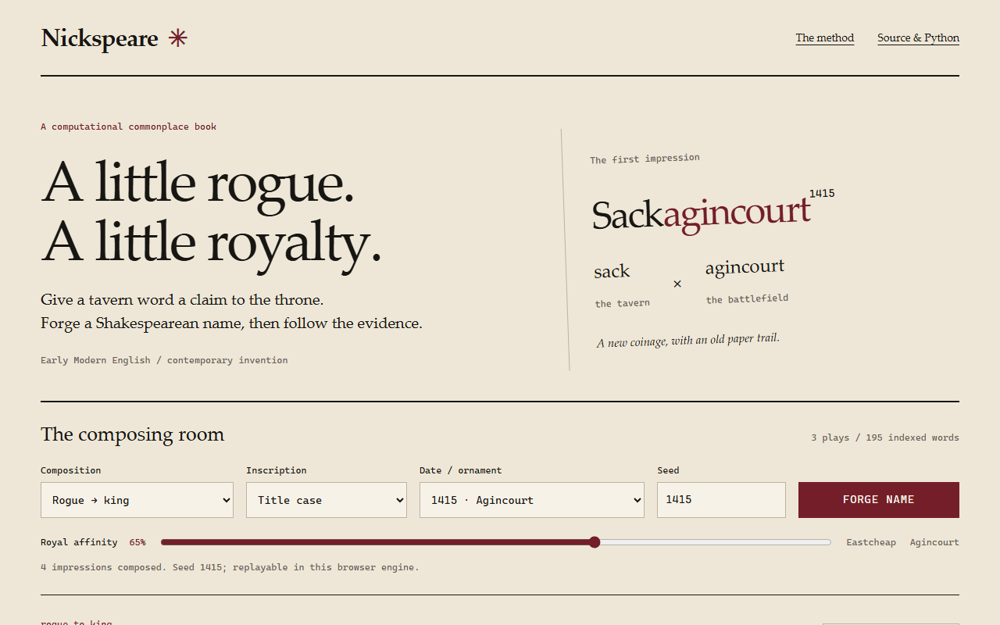

# Nickspeare

A Shakespearean nickname generator with source-linked provenance, a browser composing room and an offline-first browser extension.

[简体中文](README.zh-CN.md) · [Live demo](https://styayur.github.io/Nickspeare/) · [Python v1.0.0](https://github.com/styayur/Nickspeare/releases/tag/v1.0.0) · [Extension pre-release](https://github.com/styayur/Nickspeare/releases/tag/extension-v0.1.0-alpha.1)

**Stage: Experimental.** Python and browser workflows have automated checks; sustained independent user acceptance remains outstanding. Python source declares 1.1.0 while the latest published Python release is v1.0.0. The browser extension is independently versioned and pre-released as 0.1.0-alpha.1.



## Features

- Generate invented names from Shakespearean ingredients and inspect speaker ties, source locations, formation choices and historical date explanations.
- The evidence atlas indexes 195 words from *Henry IV, Part 1*, *Henry IV, Part 2* and *Henry V*, with source hashes and XML identifiers.
- Compare ranked blends and character Markov candidates. Seeded records make runs replayable within one engine/version.
- The web composing room runs locally without a generation API or key. Inspect the four-stage formation, select alternatives, share replay settings and export JSON.
- The Manifest V3 extension generates 4–6 usernames locally in a compact popup, applies length and character constraints, remembers local preferences, copies names and can fill a user-selected username field on the active page.
- Field insertion excludes password, email, OTP and payment-like fields, protects non-empty text and never submits a form. It does not request permanent host permissions.

Evidence attests the ingredients, not the invented name. The scoring and editorial choices are explained in [Methodology](docs/METHODOLOGY.md).

## Installation / Quick Start

### Browser extension (Chromium and Edge)

Download the ZIP asset from the [extension pre-release](https://github.com/styayur/Nickspeare/releases/tag/extension-v0.1.0-alpha.1), then extract it. The folder must contain `manifest.json` at its root.

1. Open `chrome://extensions` in Chrome/Chromium or `edge://extensions` in Microsoft Edge.
2. Enable **Developer mode**.
3. Choose **Load unpacked** and select the extracted folder.
4. Open the Nickspeare toolbar popup, forge names, then copy a candidate or choose **Use on page** to select a field explicitly.

The popup works without a page field and without a network connection. It requests `activeTab`, `scripting` and `storage` only: page access occurs after the toolbar action, generation runs from bundled data, and preferences stay in `chrome.storage.local`. No page contents, account data or browsing history are collected or transmitted. See [Extension details](docs/EXTENSION.md) and the [browser extension Privacy Policy](https://styayur.github.io/Nickspeare/privacy-policy.html).

To build the unpacked extension from source:

```sh
npm ci
npm run build:extension
```

Load `dist/extension` as the unpacked extension. Android browsers, Firefox and browser stores are not distributed in this release.

### Web composing room

Open the [live demo](https://styayur.github.io/Nickspeare/) and choose **FORGE NAME**. Inspect the paper trail and formation steps before copying a name or exporting its record. To serve the same static UI locally:

```sh
git clone https://github.com/styayur/Nickspeare.git
cd Nickspeare
python -m http.server 8765 --directory docs
```

Open `http://localhost:8765`. The packaged atlas is included, so a corpus download is not needed for ordinary generation.

The web app keeps current results in memory, without a saved-history store. Export JSON to keep a record; replay links expose the rule, style, suffix, seed, affinity and selected impression in their URL. They are not private backups. Exported JSON is a record, not an importable project file; replay is tied to the browser engine/version.

### Python from source

Use Python 3.9+; there are no third-party runtime dependencies. A virtual environment is recommended.

```sh
git clone https://github.com/styayur/Nickspeare.git
cd Nickspeare
python -m pip install -e .
python -m nickspeare generate -n 10 --seed 42
python -m nickspeare generate -n 5 --rule rogue_to_king --year-theme agincourt --royal-affinity 0.85 --json
python -m nickspeare generate -n 5 --rule markov_coin --suffix none --seed 42
```

Python offers `rogue_to_king`, `quote_splice`, `archaic_coinage`, `markov_coin` and `markov_epithet`; the browser offers the first four. `--suffix none` adds no year, `number` adds a nonhistorical ornament, and `both` chooses a historical or numeric suffix. Run `python -m nickspeare generate --help` for styles and other options.

```python
from nickspeare import NicknameGenerator

engine = NicknameGenerator(seed=42, royal_affinity=0.85)
name = engine.generate_one(rule="rogue_to_king", year_theme="agincourt")
print(name.variant)
print(name.as_dict()["provenance"])
```

For a fixed published Python package, download the wheel attached to [v1.0.0](https://github.com/styayur/Nickspeare/releases/tag/v1.0.0) and install that local file. No PyPI availability or 1.1.0 release is implied.

```sh
python -m pip install ./nickspeare-1.0.0-py3-none-any.whl
```

Corpus rebuilding and optional R/RStudio analysis are covered in [Development](docs/DEVELOPMENT.md).

## Testing / CI / Platform Support

[](https://github.com/styayur/Nickspeare/actions/workflows/ci.yml)

From the repository root, use Python 3.9+ and Node.js 22 (CI; the manifest allows Node 20+):

```sh
python -m pip install -e '.[dev]'
python -m unittest discover -s tests -v
npm ci
npm test
npm run test:coverage
python -m build
```

Extension integration tests load the built Manifest V3 package in a real Chromium profile and run popup, offline generation, clipboard, preferences, field detection, non-empty protection, React controlled-input, permission-denial and restricted-page checks. The test-only build grants loopback host access solely to exercise insertion against local fixtures; the release build has no host permissions.

```sh
python -m pip install playwright
python -m playwright install chromium
npm run test:extension
```

On Linux, run the extension test under `xvfb-run -a` because extension loading requires a headed Chromium session. On Windows, the same suite can be run with actual Edge:

```sh
python scripts/test_extension.py --browser msedge
```

Release evidence commands:

```sh
npm run audit:extension
npm run package:extension
python scripts/generate_extension_acceptance.py --help
```

The [Verify workflow](.github/workflows/ci.yml) tests Python 3.9/3.12/3.14, the Pages browser, and the packed extension on Ubuntu Chromium. [CodeForge regression](.github/workflows/codeforge-regression.yml) is a separate development gate. These checks do not certify every browser or operating system; GitHub Pages serves `main:/docs`.

## Known Limitations

- Generated names are neologisms, not Shakespeare quotations or historical pronunciation reconstructions. Speaker groups are editorial interpretations, and rare-word associations remain uncertain.
- Python and browser use different RNGs and transformation rules. Seeds replay within an engine/version, not across engines.
- The provenance atlas covers three plays and 195 words. Supplemental training corpora do not automatically extend the committed evidence index.
- Browser v0.1 does not inspect iframes or closed shadow roots, does not display automatic in-page suggestions, and does not check username availability with a remote service.
- The extension targets Chromium and Edge. Firefox is retained as a future compatibility goal, not a v0.1 release target. Store submission is not part of this pre-release.
- R is optional analysis tooling; its exploratory output is not the published evidence atlas. Sustained independent acceptance has not been audited.

## Roadmap

Current source provides generation, per-name provenance, an offline extension and reviewed release evidence. Next work is an audited corpus extension, clearer evidence views and optional user-authorized in-page suggestions. See the [corpus acceptance workflow](docs/corpus-extension.md). Ungrounded generation and commercial name services are not planned.

## Contributing

Read [CONTRIBUTING.md](CONTRIBUTING.md) and [Development](docs/DEVELOPMENT.md). Bug reports should include the engine/version, seed, rule, suffix and exported record. Use [Issues](https://github.com/styayur/Nickspeare/issues) for reproducible bugs and [SECURITY.md](SECURITY.md) for vulnerabilities. New corpus evidence needs reviewed hashes and attribution.

## License

Code is [AGPL-3.0-or-later](LICENSE). The cached Folger edition and its derived atlas retain **CC BY-NC 3.0** attribution and noncommercial restrictions; the code license does not relicense those data. See [Sources and rights](DATA_SOURCES.md) for edition credits, hashes and optional corpora. The extension is not offered as an unrestricted commercial dataset or naming service. Thanks to the Folger Shakespeare Library and its editors/encoders; Markov influences are recorded there.
