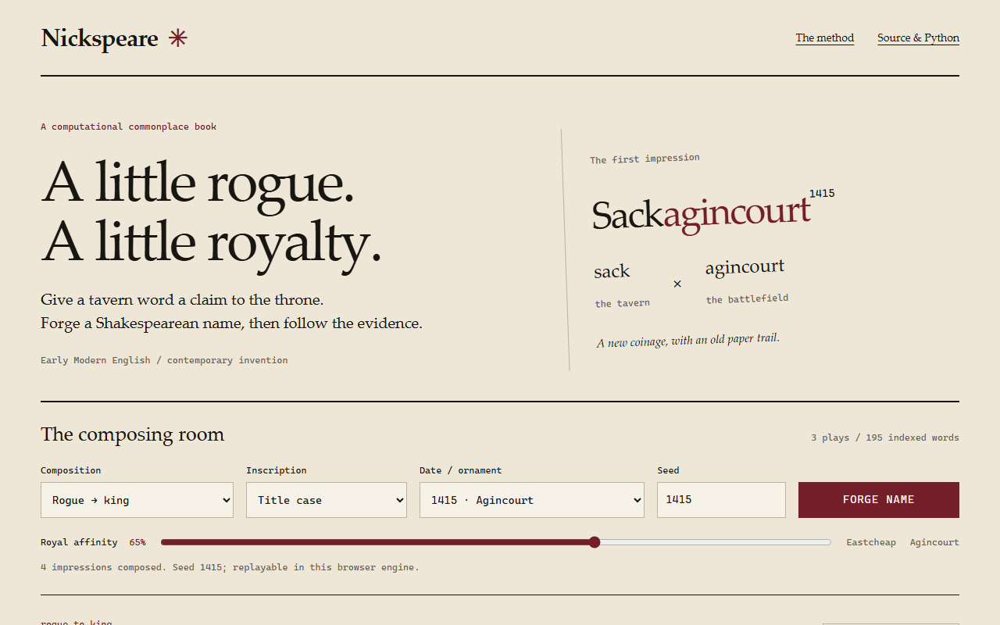

# Nickspeare

带有来源追溯记录、浏览器创作界面和离线优先浏览器扩展的莎士比亚风格昵称生成器。

[English](README.md) · [在线演示](https://styayur.github.io/Nickspeare/) · [Python v1.0.0](https://github.com/styayur/Nickspeare/releases/tag/v1.0.0) · [浏览器扩展预发布](https://github.com/styayur/Nickspeare/releases/tag/extension-v0.1.0-alpha.1)

**阶段：Experimental。** Python 与浏览器流程已有自动检查，持续性的独立用户验收仍待完成。Python 源码声明版本为 1.1.0，最新正式发布为 v1.0.0；浏览器扩展独立版本化，以 0.1.0-alpha.1 预发布。



## 功能

- 用莎士比亚文本中的词汇材料生成新昵称，查看人物关联、原文位置、构词选择和历史日期解释。
- 证据索引涵盖《亨利四世（上）》《亨利四世（下）》和《亨利五世》的 195 个词，保留来源哈希与 XML 标识。
- 比较排序后的融合词和字符 Markov 候选；带种子的记录可在同一引擎与版本内复现。
- 网页创作界面在本地生成，不需要生成 API 或密钥，可检查四步构词过程、选择候选、分享重放设置并导出 JSON。
- Manifest V3 扩展可在紧凑 Popup 中本地生成 4–6 个用户名，应用长度与字符规则、记忆本地偏好、复制用户名，并填入用户明确选择的当前页面用户名字段。
- 字段填入排除密码、邮箱、OTP 与支付类字段，保护非空文本，且绝不自动提交表单。正式构建不申请永久站点权限。

证据支持词汇材料的来源，不证明新昵称曾出现在原文中。评分与编辑选择见[方法说明](docs/METHODOLOGY.md)。

## 安装 / 快速开始

### 浏览器扩展（Chromium 与 Edge）

从[扩展预发布](https://github.com/styayur/Nickspeare/releases/tag/extension-v0.1.0-alpha.1)下载 ZIP 并解压；文件夹根目录应直接包含 `manifest.json`。

1. 在 Chrome/Chromium 打开 `chrome://extensions`，或在 Microsoft Edge 打开 `edge://extensions`。
2. 启用**开发者模式**。
3. 点击**加载已解压的扩展程序**，选择解压后的文件夹。
4. 打开工具栏中的 Nickspeare Popup，生成名字后可复制候选，或点击 **Use on page** 明确选择要填入的字段。

即使当前页面没有用户名字段，也可正常生成和复制；普通生成与复制无需网络。扩展只申请 `activeTab`、`scripting` 和 `storage`：页面访问发生在用户点击扩展之后，生成使用内置数据，偏好保存在 `chrome.storage.local`。不收集、不上传页面内容、账户信息或浏览历史。详见[扩展说明](docs/EXTENSION.md)。

从源码构建可加载版本：

```sh
npm ci
npm run build:extension
```

在浏览器中加载 `dist/extension`。本版本不发布 Firefox、移动浏览器或应用商店版本。

### 网页创作界面

打开[在线演示](https://styayur.github.io/Nickspeare/)，点击 **FORGE NAME**；复制昵称或导出记录前，可查看来源与构词步骤。要本地运行：

```sh
git clone https://github.com/styayur/Nickspeare.git
cd Nickspeare
python -m http.server 8765 --directory docs
```

打开 `http://localhost:8765`。Python 只提供文件服务，昵称生成发生在浏览器内。仓库已包含证据索引，日常生成无需下载完整语料。

网页仅在内存中保留当前结果。需要留存时请导出 JSON；重放链接会在 URL 中暴露规则、样式、后缀、种子、倾向值与所选候选编号，不是私有备份。重放依赖浏览器引擎与版本。

### 从源码安装 Python 包

使用 Python 3.9 及以上，没有第三方运行时依赖；建议使用虚拟环境。

```sh
git clone https://github.com/styayur/Nickspeare.git
cd Nickspeare
python -m pip install -e .
python -m nickspeare generate -n 10 --seed 42
python -m nickspeare generate -n 5 --rule rogue_to_king --year-theme agincourt --royal-affinity 0.85 --json
python -m nickspeare generate -n 5 --rule markov_coin --suffix none --seed 42
```

Python 提供 `rogue_to_king`、`quote_splice`、`archaic_coinage`、`markov_coin` 和 `markov_epithet`，浏览器提供前四种。`--suffix none` 不附加年份，`number` 添加无历史含义的装饰数字，`both` 在历史与数字后缀之间选择。

```python
from nickspeare import NicknameGenerator

engine = NicknameGenerator(seed=42, royal_affinity=0.85)
name = engine.generate_one(rule="rogue_to_king", year_theme="agincourt")
print(name.variant)
print(name.as_dict()["provenance"])
```

如需固定的 Python 发布包，请下载 [v1.0.0](https://github.com/styayur/Nickspeare/releases/tag/v1.0.0) 附带的 wheel。本说明不表示 PyPI 可用，也不表示 1.1.0 已发布。

```sh
python -m pip install ./nickspeare-1.0.0-py3-none-any.whl
```

## 测试 / CI / 平台支持

[](https://github.com/styayur/Nickspeare/actions/workflows/ci.yml)

在仓库根目录使用 Python 3.9 及以上、Node.js 22：

```sh
python -m pip install -e '.[dev]'
python -m unittest discover -s tests -v
npm ci
npm test
npm run test:coverage
python -m build
```

扩展集成测试会在真实 Chromium 配置中加载 Manifest V3 构建，并检查 Popup、离线生成、剪贴板、偏好、字段识别、非空保护、React 受控输入、权限拒绝与受限页面。测试专用构建仅为本地回环地址授予主机权限；正式构建没有主机权限。

```sh
python -m pip install playwright
python -m playwright install chromium
npm run test:extension
```

Linux 上需用 `xvfb-run -a` 运行有界面的 Chromium。Windows 可使用实际 Edge：

```sh
python scripts/test_extension.py --browser msedge
```

发布证据命令：

```sh
npm run audit:extension
npm run package:extension
python scripts/generate_extension_acceptance.py --help
```

[Verify 工作流](.github/workflows/ci.yml)检查 Python 3.9/3.12/3.14、网页回归与 Ubuntu Chromium 扩展加载。[CodeForge regression](.github/workflows/codeforge-regression.yml)是独立开发门禁。这些检查不代表认证所有浏览器与操作系统。

## 已知限制

- 昵称是新造词，不是莎士比亚原句或历史语音重建。人物分组属于编辑判断，低频词关联具有不确定性。
- Python 与浏览器的随机数生成器和变换规则不同；种子只在同一引擎与版本内复现。
- 来源索引限于三部剧作、195 个词。补充训练语料不会自动扩充已提交的证据索引。
- 浏览器扩展 v0.1 不访问 iframe 或 closed shadow root，不显示自动页内建议，也不向远程服务检查用户名是否可用。
- 扩展以 Chromium 和 Edge 为目标；Firefox 是未来兼容目标，不是 v0.1 发布目标。本预发布不包含商店提交。
- R 是可选分析工具，其探索性输出不是正式证据索引。持续性的独立用户验收尚未完成。

## 路线图

当前已有昵称生成、逐项来源追溯、离线扩展与可复核发布证据。下一步是经过审核的语料扩充、更清晰的证据展示和可选的用户授权页内建议。参阅[语料验收流程](docs/corpus-extension.md)。不计划提供缺乏依据的生成或商业命名服务。

## 贡献

阅读 [CONTRIBUTING.md](CONTRIBUTING.md)和[开发说明](docs/DEVELOPMENT.md)。问题报告应包含引擎与版本、种子、规则、后缀和导出记录。可复现问题提交 [Issue](https://github.com/styayur/Nickspeare/issues)，漏洞按 [SECURITY.md](SECURITY.md) 报告。新增语料证据需要审核哈希和署名。

## 许可证

代码采用 [AGPL-3.0-or-later](LICENSE)。缓存的 Folger 版本及其衍生索引保留 **CC BY-NC 3.0** 署名与非商业限制，代码许可证不重新许可这些数据。版本署名、哈希和可选语料见[来源与权利](DATA_SOURCES.md)。扩展不提供无限制商业数据或命名服务。感谢 Folger Shakespeare Library 及编辑和编码人员；Markov 方法参考也记录在该文档中。
